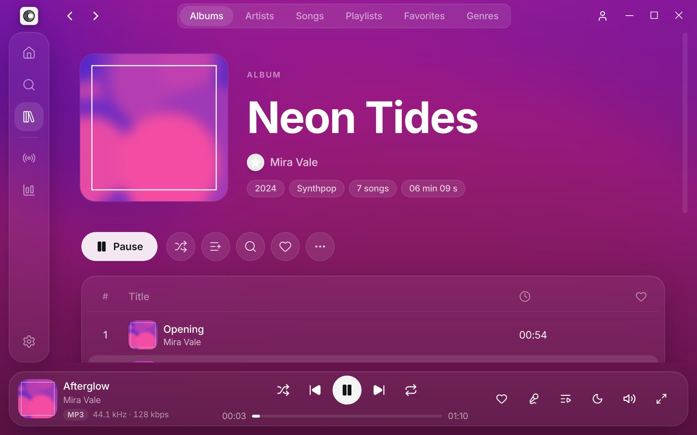
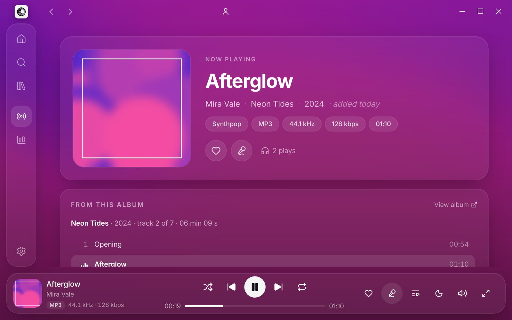
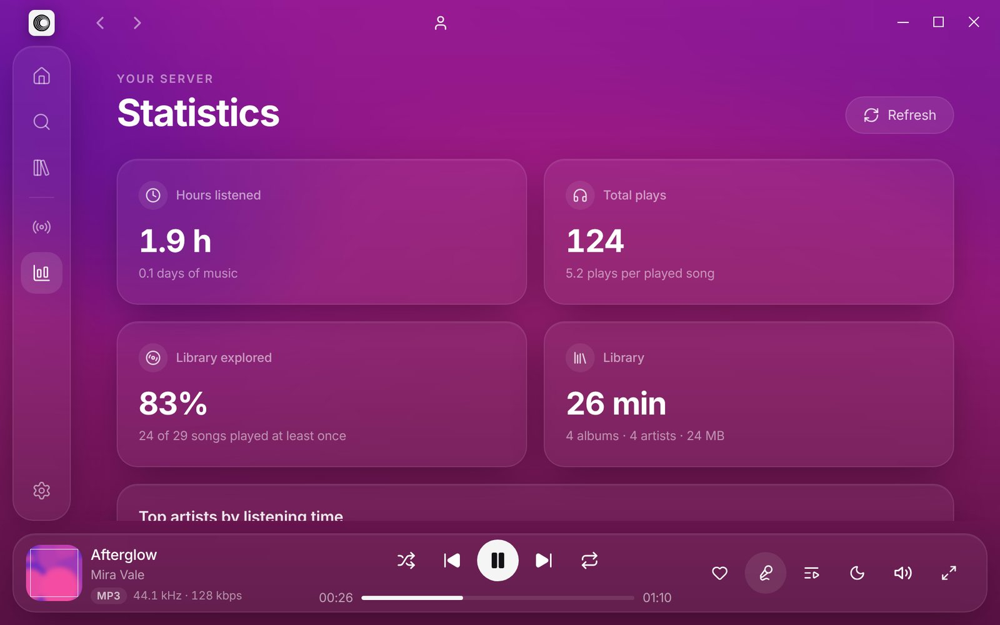
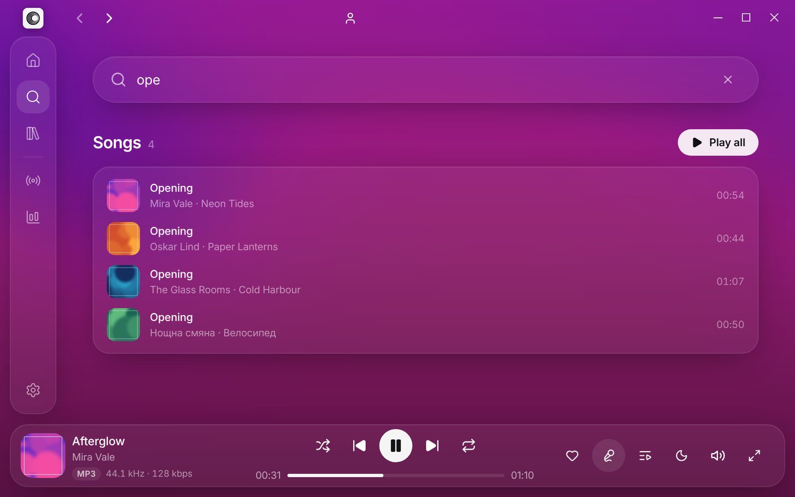
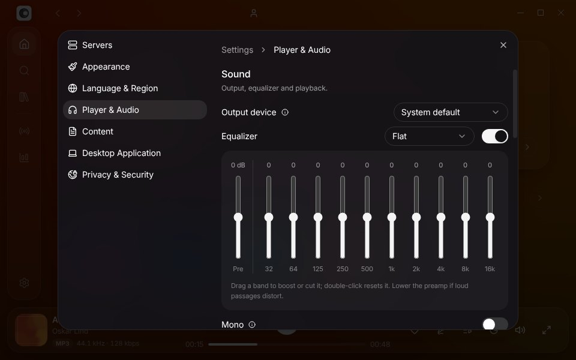

<div align="center">


# ClearPlay

**A calm, frosted-glass desktop player for your [Navidrome](https://www.navidrome.org/) server.**

Linux · Windows · works with any OpenSubsonic server

[](https://github.com/tonihk00/ClearPlay/releases/latest)
[](https://github.com/tonihk00/ClearPlay/actions)
[](LICENSE.txt)



</div>

## Why ClearPlay

You host your own music. Your player should feel as good as the streaming apps, without their clutter.

- **Looks like your music.** The current cover, softly blurred, tints the whole window. Panels are frosted glass with rounded corners, the type is Inter, and the motion is slow and quiet.
- **Lyrics that glide.** Time-synced lyrics from your own files, with the current line large and bright and the rest gently fading. They are available full screen or in a side panel on any page.
- **Built for a home server.** Save your home and Tailscale addresses and switch with one click, or let ClearPlay pick the fastest one at start. Cap the streaming bitrate when you're away.
- **Knows your listening.** A Now Playing page with the album, the artist and their discography, plus statistics: hours listened, top artists, genres, songs and decades.
- **Plays well with your other apps.** Plays go to Navidrome (and on to Last.fm/ListenBrainz), queued and retried if you're offline. Your queue can sync through the server, so Symfonium on your phone can continue where the desktop stopped.

## Screenshots

| | |
|---|---|
|  |  |
| **Fullscreen player.** Moving cover blur, synced lyrics | **Side panel.** Lyrics or queue on any page |
|  |  |
| **Now Playing.** Track, album, artist, discography | **Statistics.** Hours, plays, top artists and genres |
|  |  |
| **Search.** As you type, songs, albums and artists | **Sound.** 10-band EQ, output device, speed |

<sub>Screenshots use a generated demo library.</sub>

## Features

**Listening**
- Albums, artists, songs, playlists, favourites, genres; queue, shuffle, repeat; likes
- Time-synced lyrics from your server (`.lrc` files or embedded); LRCLIB lookup is optional
- Audio quality in the player bar: format, bit depth, sample rate, bitrate, plus a Hi-Res badge
- 10-band equalizer with presets and preamp, output device selection, mono, playback speed
- Sleep timer (minutes or end of song), ReplayGain
- Keep playing similar music when the queue runs out (uses Navidrome's Last.fm data, or the same genre)

**Your server**
- Several saved servers (home, Tailscale, a friend's) with latency check and one-click switching
- Optional: connect to the fastest server automatically at start
- Streaming-quality cap (Original, 320 to 96 kbps; Opus, MP3 or AAC) for mobile data
- Scrobbling with an offline queue and an activity log
- Play-queue sync with Navidrome (save, load, or automatic) and save queue as playlist
- Who's listening now on the server; library and listening statistics

**Desktop**
- System media controls: MPRIS on Linux; media keys and SMTC on Windows (not yet confirmed on Windows)
- Tray icon, mini player, keyboard shortcuts (`Ctrl+K` quick search)
- Reduce-effects mode for older GPUs; adjustable background strength

## Download

Get the latest build from **[Releases](https://github.com/tonihk00/ClearPlay/releases/latest)**:

| System | File | Install |
|---|---|---|
| Any Linux | `ClearPlay-*.AppImage` | `chmod +x ClearPlay-*.AppImage && ./ClearPlay-*.AppImage` |
| Debian, Ubuntu, Mint | `ClearPlay-*.deb` | `sudo apt install ./ClearPlay-*.deb` |
| Fedora, RHEL, openSUSE | `ClearPlay-*.rpm` | `sudo dnf install ./ClearPlay-*.rpm` |
| Windows 10/11 | `ClearPlay-*-win-x64.exe` | run the installer* |
| Android (Symfonium) | `ClearPlay-Glass-Style.json` (full style) or `ClearPlay-Glass.json` (colours) | see [themes/symfonium](themes/symfonium/README.md) |

<sub>*The Windows installer isn't code-signed, so SmartScreen may warn on first run: More info → Run anyway.</sub>

On first start, enter your server address (for example `http://192.168.1.10:4533` or your Tailscale address `http://100.x.y.z:4533`), username and password.

## Good to know

- **Lyrics:** put `.lrc` files next to your music (same name as the track) or embed synced lyrics; Navidrome serves them.
- **ListenBrainz / Last.fm:** link them in Navidrome (your user → Personal). ClearPlay reports plays to Navidrome, which forwards them.
- **Similar songs:** needs a Last.fm API key in Navidrome; without it ClearPlay falls back to songs of the same genre.
- **Bitrate cap:** needs transcoding (ffmpeg) enabled in Navidrome.
- **Hi-res:** ClearPlay shows your files' real quality, but plays through Chromium's audio engine, which mixes at the system rate. Exclusive or bit-perfect output isn't possible in this app.

## Build from source

Requirements: Node.js 24 and pnpm 11 (`corepack enable`).

```bash
git clone https://github.com/tonihk00/ClearPlay.git
cd ClearPlay
pnpm install
pnpm electron:dev                         # run with hot reload
pnpm electron:build && pnpm build:linux   # AppImage, deb, rpm (rpm needs rpmbuild)
pnpm build:win                            # Windows installer (best on Windows or CI)
```

Every push builds Linux and Windows packages in GitHub Actions. Bumping `version` in `package.json` publishes a release automatically.

## Credits

ClearPlay began as a fork of [Aonsoku](https://github.com/victoralvesf/aonsoku) by Victor Alves (MIT). The visual design, logo and the features listed above are ClearPlay's own. Inter typeface (SIL OFL 1.1), Lucide icons (ISC). See [NOTICE.md](NOTICE.md) and [CHANGELOG.md](CHANGELOG.md).

## Licence

MIT
