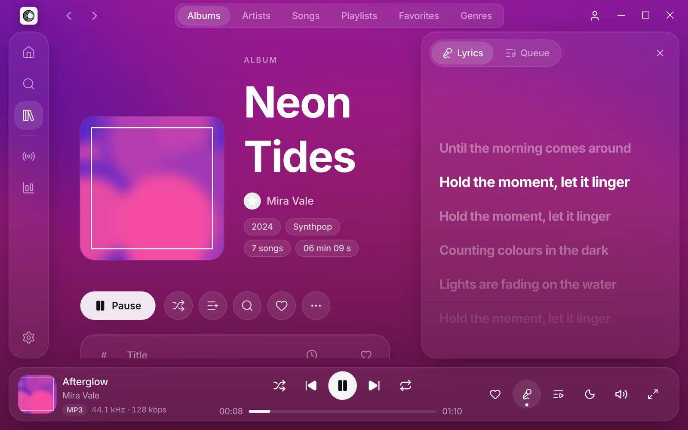
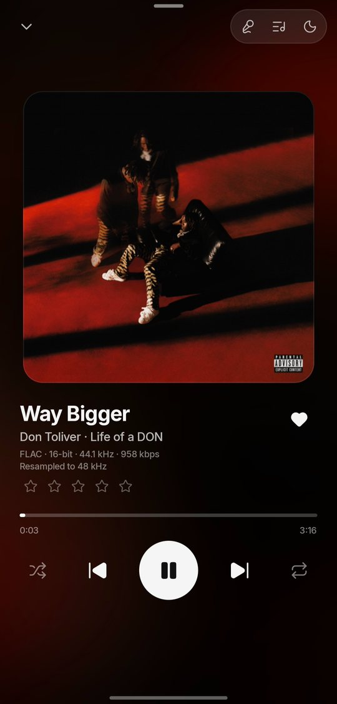
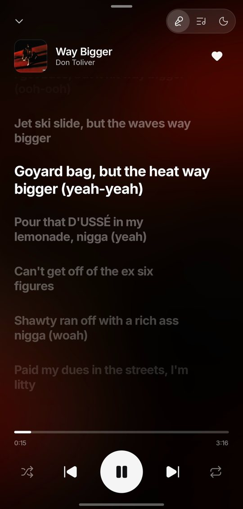
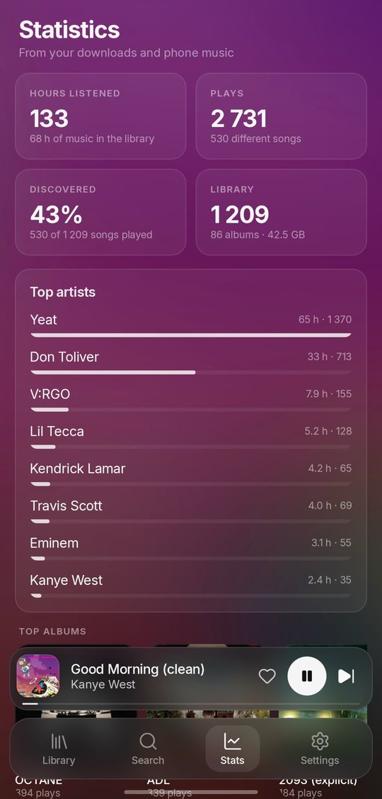

<div align="center">


# Rimelight

**A calm, frosted-glass desktop player for your [Navidrome](https://www.navidrome.org/) server.**

Linux · Windows · works with any OpenSubsonic server

[](https://github.com/Rimelight-app/Rimelight/releases/latest)
[](https://github.com/Rimelight-app/Rimelight/actions)
[](LICENSE.txt)


<!-- SCREENSHOT TO ADD (near the top, below the album shot or replacing it):
     docs/screenshots/continue.mp4 (or .gif), at most 10 s and 5 MB.
     Shot: 1280×800 window, a real album playing in the fullscreen player with synced lyrics
     scrolling for ~5 s; OR the Continue flow: the "Paused on ClearPlay Android · <song> · 2 min ago"
     pill above the player bar, click Continue, the song starts at the same second.
     Alt text: "Rimelight continuing a song from the phone at the same second" (or
     "Synced lyrics gliding in Rimelight's fullscreen player"). -->

</div>

Rimelight is a desktop music player for Navidrome and other Subsonic / OpenSubsonic servers, for Windows and Linux, with a frosted-glass interface, synced lyrics and bit-perfect playback.

## Why Rimelight

You host your own music. Your player should feel as good as the streaming apps, without their clutter.

- **Looks like your music.** The current cover, softly blurred, tints the whole window. Panels are frosted glass with rounded corners, the type is Inter, and the motion is slow and quiet.
- **Lyrics that glide.** Time-synced lyrics from your own files, with the current line large and bright and the rest gently fading. They are available full screen or in a side panel on any page.
- **Built for a home server.** Save your home and Tailscale addresses and switch with one click, or let Rimelight pick the fastest one at start. Cap the streaming bitrate when you're away.
- **Knows your listening.** A Now Playing page with the album, the artist and their discography, plus statistics: hours listened, top artists, genres, songs and decades.
- **Continue on other devices.** Pause on one device, tap Continue on the other, and it picks up at the same song and second, through your server. Works with ClearPlay for Android 1.6.0 and with other apps such as Symfonium.
- **Plays well with your other apps.** Plays go to Navidrome (and on to Last.fm/ListenBrainz), queued and retried if you're offline.

## Screenshots

| | |
|---|---|
|  |  |
| **Home.** Featured, recently and most played | **Fullscreen player.** Cover, controls and synced lyrics |
|  |  |
| **Artist page.** Biography, with lyrics in the side panel | **Statistics.** Hours, plays, top artists and genres, with the queue |

### ClearPlay for Android

| | | | | |
|---|---|---|---|---|
|  |  |  |  |  |
| **Album** | **Now playing** | **Lyrics** | **Statistics** | **Settings** |

**ClearPlay for Android** is the same frosted-glass player for your server on your phone, with synced lyrics, statistics and Continue on other devices. Get it from [its releases](https://github.com/Rimelight-app/Rimelight/releases/tag/android-v1.6.0).

<!-- SCREENSHOTS TO ADD (desktop, real library, 1440×900 window):
     1. docs/screenshots/settings.jpg — Settings → Player & Audio, the frosted cards (changed in 0.5.2),
        Audio engine and Sound groups visible. Alt: "Rimelight settings: audio engine and sound".
     2. docs/screenshots/continue-pill.jpg — any page with the pill above the player bar:
        "Paused on ClearPlay Android · <song> · 2 min ago" with the Continue button.
        Alt: "The Continue pill offering the queue paused on the phone".
     3. docs/screenshots/start-radio.jpg — an album page, a song right-clicked, the menu open
        with "Start radio" under "Add last". Alt: "Start radio in a song's menu". -->

<sub>Screenshots from a real Navidrome library. Album art and lyrics belong to their artists and labels.</sub>

## Features

**Listening**
- Albums, artists, songs, playlists, favourites, genres; queue, shuffle, repeat; likes and 1–5 star ratings
- Shuffle the whole library; clearing the queue keeps the song that's playing
- Drag songs in the queue to change their order; Play next / Add to the end, confirmed by a small pill above the player bar
- Time-synced lyrics from your server (`.lrc` files or embedded); LRCLIB lookup is optional
- Audio quality in the player bar: format, bit depth, sample rate, bitrate, plus a Hi-Res badge
- 10-band equalizer with presets and preamp, output device selection, mono, playback speed
- Optional bit-perfect engine (mpv): each song goes to your DAC unchanged, at its own sample rate and bit depth, with exclusive access to the device. Rimelight reads what the device supports, converts only what it can't play, uses its hardware volume, starts quiet on a new device, and shows the song's path ("Bit-perfect · 96 kHz · 24-bit") in Settings and, if you like, the player bar. Linux needs mpv installed (`sudo dnf install mpv`); the Windows installer includes it
- Sleep timer (minutes or end of song), ReplayGain
- Keep playing similar music when the queue runs out (uses Navidrome's Last.fm data, or the same genre)
- Start radio from a song, an album or an artist (right-click, the "…" menu or `Ctrl+K`): a new queue of similar music that keeps going
- A song that can't be played is tried once more, then skipped with a short message; if the server can't be reached, Rimelight pauses and says so instead of skipping. When the queue ends, it stays
- Optional spectrum visualizer on the Now Playing page (Settings → Appearance)

**No server? Music on this computer**
- Add music folders on this computer (login page or Settings → Servers) and use the whole app without a server: browsing, search, lyrics (`.lrc` or embedded in the file, synced lines kept as written), cover art, likes, ratings, playlists, play counts
- Folders are rescanned at start; only new or changed files are read

**Your server**
- Several saved servers (home, Tailscale, a friend's) with latency check and one-click switching
- Optional: connect to the fastest server automatically at start
- Streaming-quality cap (Original, 320 to 96 kbps; Opus, MP3 or AAC) for mobile data
- Scrobbling with an offline queue and an activity log
- Continue on other devices (Settings → Queue): your queue and position are saved to the server, and a pill offers to continue what another device left; also save the queue as a playlist
- Navidrome's Now Playing shows when you pause (on servers with the OpenSubsonic `playbackReport` extension, such as Navidrome 0.64)
- Who's listening now on the server; library and listening statistics
- If the server is off when Rimelight starts, it opens anyway and reconnects by itself; a page that fails to load says why and offers Retry

**Desktop**
- System media controls: MPRIS on Linux; media keys and SMTC on Windows (not yet confirmed on Windows)
- Tray icon, keyboard shortcuts (`Ctrl+K` quick search and commands)
- Song progress on the taskbar button (Windows): green while playing, yellow when paused, red when a song couldn't play
- Reduce-effects mode for older GPUs; adjustable background strength
- Checks GitHub for a new version at start and offers to install it

## Download

Get the latest build from **[Releases](https://github.com/Rimelight-app/Rimelight/releases/latest)**:

| System | File | Install |
|---|---|---|
| Any Linux | `Rimelight-*.AppImage` | `chmod +x Rimelight-*.AppImage && ./Rimelight-*.AppImage` |
| Debian, Ubuntu, Mint | `Rimelight-*.deb` | `sudo apt install ./Rimelight-*.deb` |
| Fedora, RHEL, openSUSE | `Rimelight-*.rpm` | `sudo dnf install ./Rimelight-*.rpm` |
| Windows 10/11 | `Rimelight-*-win-x64.exe` | run the installer* |

<sub>*The Windows installer isn't code-signed, so SmartScreen may warn on first run: More info → Run anyway.</sub>

**Coming from ClearPlay?** Rimelight is the same app under a new name. ClearPlay 0.6.1 offers the update itself; your servers, settings and queue carry over. The Rimelight `.deb` and `.rpm` replace the `clearplay` package when you install them.

On first start, enter your server address (for example `http://192.168.1.10:4533` or your Tailscale address `http://100.x.y.z:4533`), username and password.

## Good to know

- **Lyrics:** put `.lrc` files next to your music (same name as the track) or embed synced lyrics; Navidrome serves them.
- **ListenBrainz / Last.fm:** link them in Navidrome (your user → Personal). Rimelight reports plays to Navidrome, which forwards them.
- **Similar songs and Start radio:** best with a Last.fm API key in Navidrome; without it you get songs of the same genre.
- **Bitrate cap:** needs transcoding (ffmpeg) enabled in Navidrome.
- **Music on this computer:** the built-in engine plays what Chromium can decode (MP3, FLAC, Ogg/Opus, AAC/M4A, WAV); ALAC `.m4a` plays only with the bit-perfect engine. The bitrate cap doesn't apply (there's no transcoding). Artist bios, similar-artist data and Start radio need a server.
- **Hi-res:** Rimelight shows your files' real quality. The built-in engine plays through Chromium's audio, which mixes at the system rate. The bit-perfect engine (Settings → Player & Audio → Audio engine) plays each song unchanged, with exclusive access to the device.

## Is Rimelight for you?

For you if you have Navidrome or another OpenSubsonic server (or just music folders on your computer), use Windows or Linux, and want a player that looks good.

Not (yet): macOS, gapless playback with the bit-perfect engine, a code-signed Windows installer.

## FAQ

**Does it work with Navidrome, Gonic or other servers?** It speaks the Subsonic / OpenSubsonic API and is tested with Navidrome 0.64. Other servers should work for the basics; a few features use OpenSubsonic extensions that Navidrome has.

**Does it show synced lyrics?** Yes, from `.lrc` files or lyrics embedded in your files, served by your server (or read from the files with "Music on this computer"). LRCLIB lookup is optional.

**Is playback bit-perfect?** With the optional mpv engine, yes: each song reaches your DAC unchanged, at its own rate and bit depth. The default engine mixes at the system rate.

**Can I continue on my phone?** Yes. Turn on Continue on other devices and pause here; ClearPlay for Android 1.6.0 (or another app that reads Navidrome's saved queue, such as Symfonium) continues at the same song and second, and back.

**Does it work without a server?** Yes: choose "Use music on this computer" and add your music folders.

**Is it free and open source?** Yes, MIT-licensed, built from this repository.

## Build from source

Requirements: Node.js 24 and pnpm 11 (`corepack enable`).

```bash
git clone https://github.com/Rimelight-app/Rimelight.git
cd Rimelight
pnpm install
pnpm electron:dev                         # run with hot reload
pnpm electron:build && pnpm build:linux   # AppImage, deb, rpm (rpm needs rpmbuild)
pnpm build:win                            # Windows installer (best on Windows or CI)
```

Every push builds Linux and Windows packages in GitHub Actions. Bumping `version` in `package.json` publishes a release automatically.

## Credits

Rimelight was called ClearPlay up to version 0.6.1. It began as a fork of [Aonsoku](https://github.com/victoralvesf/aonsoku) by Victor Alves (MIT). The visual design, logo and the features listed above are Rimelight's own. Inter typeface (SIL OFL 1.1), Lucide icons (ISC). See [NOTICE.md](NOTICE.md) and [CHANGELOG.md](CHANGELOG.md).

## Licence

MIT
